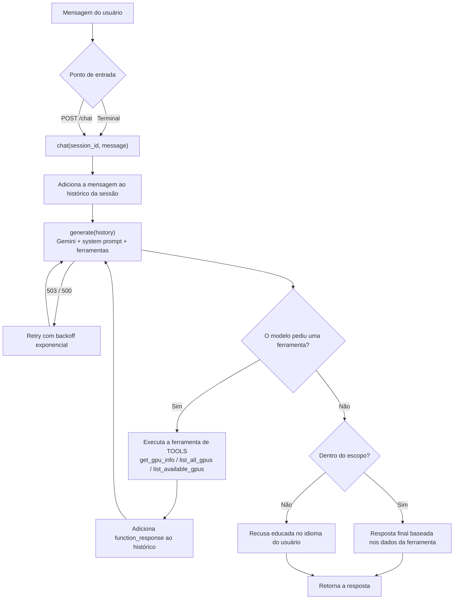

# Assistente de Infraestrutura de GPUs

Um assistente de IA conversacional que responde perguntas sobre uma infraestrutura de GPUs (simulada): quais modelos existem, quanta VRAM eles têm e quantas unidades estão livres. Ele usa **function calling (tool calling) do Gemini**, então toda resposta é baseada em dados reais retornados por ferramentas, e não na memória do modelo.

Desenvolvido para o desafio de estágio em ML/GenAI na HP. Funciona como chat no terminal ou como um serviço FastAPI com front-end.

## Funcionalidades

- Tool calling com a API do Gemini (SDK `google-genai`), com loop de ferramentas manual para ter controle total e logs
- Três ferramentas: `get_gpu_info`, `list_all_gpus` e `list_available_gpus`
- Restrição de escopo: o assistente recusa perguntas que não sejam sobre a infraestrutura de GPUs
- Responde no idioma da pergunta
- Histórico de conversa por sessão
- Retry com backoff exponencial para falhas temporárias da API
- O mesmo núcleo (`chat()`) é usado pelo terminal e pela API HTTP

## Estrutura do projeto

```
app/
├── agent.py   # Cliente Gemini, system prompt, loop de ferramentas, chat()
├── tools.py   # Dados das GPUs e funções das ferramentas
├── main.py    # Rota FastAPI que chama chat()
└── .env       # GEMINI_API_KEY (não versionado)
```

## Como funciona



### Requerimentos

- [Docker](https://docs.docker.com/get-docker/) e Docker Compose
- Uma Chave de API do Gemini

## Instalação

1. Clone o repositório:

```bash
git clone https://github.com/mateussobucki/estagio-hp-machine-learning.git
cd ./estagio-hp-machine-learning
```

Crie um arquivo `.env` com uma chave do [Google AI Studio](https://aistudio.google.com) na pasta `app` do projeto:

```
GEMINI_API_KEY=sua-chave
```

3. Build e comece ambos os serviços:

```bash
docker compose up --build
```


## Uso

- Frontend: http://localhost:5173
- Backend API: http://localhost:8000 (`POST /chat`)

Para parar a aplicação, aperte `Ctrl+C` ou rode `docker compose down`.

**Terminal**

```bash
cd ./app
uv run agent.py
```

### Rodando sem Docker

Backend (precisa de Python 3.14 e [uv](https://docs.astral.sh/uv/)):

```bash
cd ./app
uv sync
uv run uvicorn main:app --reload
```

```bash
curl -X POST http://localhost:8000/chat \
  -H "Content-Type: application/json" \
  -d '{"session_id": "abc", "message": "Quais GPUs estão disponíveis?"}'
```

```json
{"reply": "As GPUs com unidades livres são: NVIDIA A100, NVIDIA L40S, NVIDIA RTX 4090 e NVIDIA A40."}
```

Use o mesmo `session_id` para continuar uma conversa.


Frontend (precisa do Node 24):

```bash
cd ./frontend
npm install
npm run dev
```

## Decisões de design

- **Loop de ferramentas manual.** O function calling automático é desativado para que cada chamada de ferramenta seja visível (`[tool] nome(args)`) e o histórico da conversa seja explícito.
- **Mensagens inteiras do modelo vão para o histórico.** `res.candidates[0].content` é adicionado como está, preservando todas as partes (chamadas de função, thought signatures) exigidas pelos modelos mais novos do Gemini.
- **Uma única função central.** `chat()` não sabe nada sobre HTTP nem sobre o terminal, então os dois pontos de entrada a compartilham. O loop do terminal fica atrás de `if __name__ == "__main__"`.
- **`temperature=0`** para um comportamento consistente em um assistente de consulta de dados.

## Problemas encontrados e como foram resolvidos

| Problema | Causa | Solução |
|---|---|---|
| Tool calling pouco confiável | A primeira versão usava um modelo local pequeno (`llama3.2:3b` via Ollama), que frequentemente ignorava as ferramentas ou gerava chamadas malformadas. Usá-lo seria possível mas deixaria o código muito mais complicado | Migração para a API do Gemini, que lida de forma confiável com function calling |
| `503 UNAVAILABLE` (alta demanda) | Sobrecarga temporária no lado do Google | Retry com backoff exponencial (1s, 2s, 4s, 8s) e número limitado de tentativas no nível do SDK |
| Respostas muito lentas | Modelo pesado somado a retries empilhados (retries do SDK em cima dos retries customizados) | Troca para um modelo `flash-lite`, definição de timeout na requisição e limite de tentativas do SDK |
| Respostas fora do escopo (por exemplo, "Qual a capital da França?" retornava "Paris") | O modelo não tinha nenhuma instrução para recusar | System prompt com regras explícitas de escopo e comportamento fixo de recusa, além de `temperature=0` |

## Limitações

- **Dados simulados.** Os dados das GPUs são um dicionário fixo em `tools.py`. Não há inventário, agendador ou monitoramento reais por trás. Em uma aplicação real, eles poderiam ser movidos para um banco de dados.
- **Sessões em memória.** O histórico é perdido ao reiniciar, não é compartilhado entre processos e cresce sem limite em conversas longas.
- **Sem autenticação nem rate limiting** na API; qualquer pessoa que consiga acessá-la pode consumir a cota do Gemini.
- **Dependência de uma API de terceiros.** Disponibilidade, latência, limites de uso e nomes de modelos dependem do Google. Modelos são descontinuados e renomeados, e não há modelo de fallback nem fallback local.
- **Somente leitura.** O assistente consulta as GPUs, mas não consegue reservá-las nem liberá-las.
- **Sem testes automatizados nem conjunto de avaliação** para a precisão das chamadas de ferramenta ou para o comportamento de escopo.
- **Sem streaming.** A resposta só é retornada depois que o loop de ferramentas termina por completo.

## Próximos passos possíveis

- Lista de modelos de fallback e fallback opcional para o Ollama local
- Sessões persistentes (SQLite ou Redis) com truncamento do histórico
- Respostas em streaming
- Backend de inventário real e ferramentas de escrita (reservar/liberar)
- Testes para chamadas de ferramenta e recusas fora do escopo
- Expor as ferramentas como um servidor MCP para que outros clientes possam usá-las
- Usar ferramentas como o opencode com modelos já treinados, com um design robusto para aplicações desktop e terminal e suporte a MCP desde o início